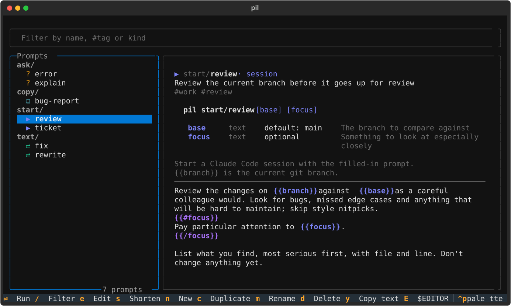
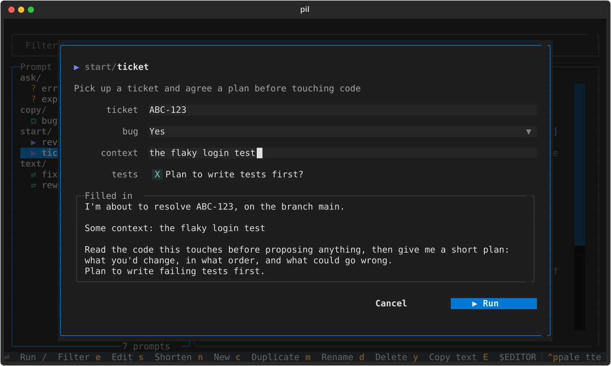
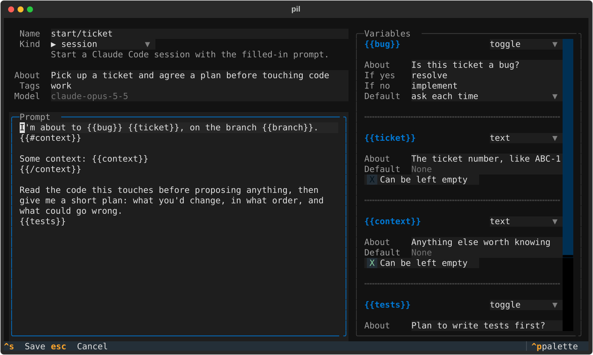

<h1 align="center">pil</h1>

<p align="center">
  <b>The prompt invocation library for <a href="https://claude.com/claude-code">Claude Code</a>.</b><br>
  Keep the prompts you use every day in one place, fill in the parts that change, and run them
  with a few keystrokes.
</p>

<p align="center">
  <a href="https://github.com/adamtrain/pil/actions/workflows/ci.yml"></a>
  
  <a href="https://github.com/astral-sh/uv"></a>
  <a href="https://github.com/astral-sh/ruff"></a>
  <a href="LICENSE"></a>
</p>

<p align="center">
  
</p>

## Why pil

- **One command per prompt.** `pil ticket ABC-123` fills in a saved prompt and starts a Claude
  Code session with it. `pil fix` rewrites whatever is on your clipboard.
- **Prompts are plain files.** Each one is a Markdown file with a little YAML on top, in a
  folder you can keep in git, sync, or edit with anything.
- **Placeholders without ceremony.** Write `{{ticket}}` in a prompt and it becomes an argument,
  a flag, a form field in the TUI and a question at the terminal if you forget it.
- **A TUI for the housekeeping.** Browse, filter, write, rename and delete prompts, and run them
  from there too.

## Install

You'll need [uv](https://docs.astral.sh/uv/) and [Claude Code](https://claude.com/claude-code).

```sh
uv tool install git+https://github.com/adamtrain/pil
```

That puts `pil` on your `PATH`. To hack on it, clone the repo and install it in editable mode,
so your changes take effect right away:

```sh
git clone https://github.com/adamtrain/pil && cd pil
uv tool install --editable .
```

For tab completion of commands, prompt names and each prompt's own variables:

```sh
pil --install-completion
```

To start with a few prompts of each kind rather than an empty library:

```sh
pil examples
```

## What a prompt can do

Every prompt has a **kind**, which says what happens when you run it.

| Kind          | What it does                                                                |
| ------------- | --------------------------------------------------------------------------- |
| `session` ▶   | Fills in the prompt and starts a Claude Code session with it.               |
| `transform` ⇄ | Runs `claude -p` on your clipboard and puts the result back on the clipboard. |
| `ask` ?       | Runs `claude -p` on your clipboard and prints the answer.                   |
| `copy` ⧉      | Fills in the prompt and copies it, without running Claude at all.           |

`transform` and `ask` prompts act on the first of these that applies: a file given with `-f`,
text piped in, or else the clipboard. The clipboard is only ever replaced by a successful
result.

## Running prompts

```sh
pil ticket ABC-123                 # fill in a prompt and start a session
pil ticket ABC-123 --no-tests      # …with one of its toggles switched off
pil fix                            # rewrite the clipboard in place
git diff | pil explain             # act on piped text instead of the clipboard
pil explain why is this slow       # free text needs no quotes
pil fix < draft.md > fixed.md      # redirected output gets the result
pil ticket -h                      # what does this prompt want?
pil -n ticket ABC-123              # just print the filled-in prompt
```

`pil NAME` is short for `pil run NAME`. A name can be given in full (`start/ticket`), by its
last part (`ticket`), or by any prefix that matches only one prompt (`tick`).

A prompt's variables become its command line:

- **Text** variables are filled by bare words, required ones first. Whatever is left over joins
  the last one, which is why free text needs no quotes. `--name value` and `name=value` work
  too.
- **Toggles** and yes-or-no questions are flags: `--tests` and `--no-tests`.
- **Choices** are flags with a value: `--tone=formal`. An unambiguous prefix (`--tone=f`) is
  enough.

If something required is missing and you're at a terminal, pil asks for it. In a script, it
stops and says what it needs. Put `--` before text that starts with dashes.

pil's own options can go either side of the name:

| Option                  | What it does                                                      |
| ----------------------- | ----------------------------------------------------------------- |
| `-n`, `--dry-run`       | Print the filled-in prompt (and the `claude` command) and stop.   |
| `-f`, `--file PATH`     | Act on a file instead of the clipboard. `-f -` reads stdin.       |
| `-o`, `--output WHERE`  | Send the result to `clipboard` or `terminal` instead.             |
| `-m`, `--model MODEL`   | Use this model for the run.                                       |
| `-r`, `--raw`           | Print answers as plain text rather than rendered Markdown.        |

After the name, a prompt's own variables win any clash: if a prompt has a variable called
`model`, then `pil compare --model x` fills that variable.

## The TUI

Run `pil` with no arguments.

<p align="center">
  
</p>

| Key       | What it does                                                             |
| --------- | ------------------------------------------------------------------------ |
| `Enter`   | Run the selected prompt, asking for its variables first if it has any.   |
| `/`       | Filter by name, `#tag` or kind. `Enter` runs the selection, `Esc` clears. |
| `e`       | Edit the prompt.                                                         |
| `s`       | Shorten the prompt's text as far as Claude can, if you approve.          |
| `n`       | Write a new prompt, starting in the folder you're looking at.            |
| `c`       | Duplicate the prompt.                                                    |
| `m`       | Rename it, or move it to another folder.                                 |
| `d`       | Delete it.                                                               |
| `y`       | Copy its text, placeholders and all.                                     |
| `E`       | Open the file in `$VISUAL` or `$EDITOR`.                                 |
| `q`       | Quit.                                                                    |

A `session` prompt closes the TUI and hands the terminal to Claude Code. A `transform` or `ask`
shows its result in place; from there `y` copies it and `u` puts the original text back on the
clipboard.

`s` asks Claude to "maximally shorten this text, keeping information, grammar, and LLM-prompt
usability", then asks again of the result, and again, until a pass fails to cut at least 5% (or
5 characters, for short prompts). You're shown the last version that was worth having beside
the original. `y` replaces the prompt's text, leaving its frontmatter untouched; `n` keeps what
you had. A pass that loses or gains a `{{variable}}` is thrown away.

Once a prompt is as short as it gets, pil remembers, and `s` just says it can't get any
shorter without asking Claude. Change the prompt's text, in pil or anywhere else, and it will
try again.

In the editor, a card appears for each variable as you type it, where you can describe it, give
it a default, turn it into a toggle or a choice, and say what text a yes or a no should put in
the prompt. `Ctrl+S` saves.

<p align="center">
  
</p>

## Writing prompts

A prompt is a Markdown file. Its name is its path inside the library, so
`~/.config/pil/prompts/start/ticket.md` is the prompt `start/ticket`.

```markdown
---
description: Pick up a ticket and agree a plan before touching code
kind: session
mode: plan
tags: [work]
vars:
  ticket: The ticket number, like ABC-123
  bug:
    help: Is this ticket a bug?
    options:
      yes: resolve
      no: implement
  context: Anything else worth knowing
  tests:
    help: Plan to write tests first?
    default: true
    options:
      yes: Plan to write failing tests first.
      no: Leave tests out of the plan; I'll handle them separately.
---

I'm about to {{bug}} {{ticket}}, on the branch {{branch}}.
{{#context}}

Some context: {{context}}
{{/context}}

Read the code this touches before proposing anything, then give me a short plan.
{{tests}}
```

Everything above the prompt's text is optional. A file with no frontmatter at all is a `session`
prompt.

### Placeholders

| Tag                      | What it does                                                    |
| ------------------------ | --------------------------------------------------------------- |
| `{{name}}`               | The value of a variable.                                        |
| `{{#name}}`…`{{/name}}`  | Text that's kept only when `name` is switched on, or not empty. |
| `{{^name}}`…`{{/name}}`  | Text that's kept only when `name` is off, or empty.             |

Anything else in double braces, like `${{ secrets.TOKEN }}`, is left alone, and `\{{name}}` is
a literal `{{name}}`.

Variables don't have to be declared. pil works out what each one is from how it's used:

- `{{name}}` alone is required text.
- `{{#name}}`…`{{/name}}` alone is a toggle, off by default.
- Both together, as in `{{#context}}Some context: {{context}}{{/context}}`, is optional text.

Declare a variable under `vars` to describe it, give it a default, or make it a choice:

```yaml
vars:
  ticket: The ticket number          # a description on its own
  base:
    default: main                    # a default makes text optional
    help: The branch to compare against
  tone:
    options: [plain, formal, terse]  # options make it a choice
    default: plain
  tests:
    type: toggle
    default: true
```

### Questions, and answers that stand for something

Give `options` as a table instead of a list and each answer stands for the text beside it.
When the answers are `yes` and `no`, the variable is a yes-or-no question:

```yaml
vars:
  bug:
    help: Is this ticket a bug?
    options:
      yes: resolve
      no: implement
```

Now `{{bug}}` reads "resolve" or "implement". Answer it with `--bug` or `--no-bug`; leave it
out and pil asks, at the terminal or in the TUI's form. Add `default: no` (or `yes`) and it's
only a flag, never a question.

Either answer can be left out, so this adds a sentence only when the answer is no:

```yaml
vars:
  tests:
    help: Should the plan include tests?
    default: yes
    options:
      no: Leave tests out of the plan.
```

`{{#bug}}`…`{{/bug}}` and `{{^bug}}`…`{{/bug}}` still follow the yes or no, for when an answer
changes more than a word or two.

A choice works the same way, with any answers you like:

```yaml
vars:
  size:
    options:
      s: Keep the change as small as possible.
      l: Take the chance to tidy up what you touch.
```

`--size=s` puts the first sentence in the prompt.

These are filled in for you and never asked for:

| Tag             | What it is                                                              |
| --------------- | ----------------------------------------------------------------------- |
| `{{input}}`     | The text the prompt acts on: `-f`, piped stdin, or else the clipboard.  |
| `{{clipboard}}` | The clipboard's contents.                                               |
| `{{branch}}`    | The current git branch.                                                 |
| `{{cwd}}`       | The current directory.                                                  |
| `{{date}}`      | Today's date, as `YYYY-MM-DD`.                                          |

A `transform` or `ask` prompt gets its input attached after the prompt, in `<input>` tags. Use
`{{input}}` to put it somewhere particular instead. Using `{{input}}` in a `session` or `copy`
prompt makes that prompt take input too.

### Settings

| Key           | What it does                                                               |
| ------------- | -------------------------------------------------------------------------- |
| `description` | A line about what the prompt is for.                                       |
| `kind`        | `session` (the default), `transform`, `ask` or `copy`.                     |
| `tags`        | Words to filter by.                                                        |
| `vars`        | Descriptions, defaults and types for the prompt's variables.               |
| `model`       | The model to use, as `claude --model` takes it. Opus 5.5 by default.       |
| `effort`      | The reasoning effort, as `claude --effort` takes it. `high` by default.    |
| `mode`        | The permission mode, such as `plan`.                                       |
| `system`      | A system prompt to use in place of the usual one.                          |
| `tools`       | The tools Claude may use: a list, `none` or `default`.                     |
| `mcp`         | `false` to run without your MCP servers.                                   |
| `args`        | Any other arguments to pass to `claude`.                                   |

`transform` and `ask` prompts are meant to be quick, so by default they run with no tools, no
MCP servers and a short system prompt that asks for the result and nothing else, and they aren't
saved to your session history. Set `tools: default`, `mcp: true` or `system: default` on a
prompt to get Claude Code's usual behavior back.

## Managing the library

```sh
pil ls                    # everything, with each prompt's arguments
pil ls review -k session  # filter by words, kind (-k) or tag (-t)
pil show ticket           # one prompt in full
pil new text/shorten -k transform -d "Cut it down"
pbpaste | pil new text/shorten -k transform    # …using piped text as the prompt
pil edit ticket           # open it in $VISUAL or $EDITOR
pil mv ticket work/ticket
pil rm ticket
pil dir                   # where the files are
```

Piped, `pil ls` prints tab-separated name, kind and description, and `pil show` prints the file
itself.

A prompt that shares its name with one of these commands can still be run with
`pil run NAME`.

## Configuration

pil keeps everything in `~/.config/pil` (or `$XDG_CONFIG_HOME/pil`). Set `$PIL_HOME` to put it
somewhere else. Besides your prompts, that's an optional `config.toml` and a small `state.json`
where pil notes which prompts are already as short as they get.

Unless told otherwise, every prompt runs on Opus 5.5 (`claude-opus-5-5`) at high effort.

An optional `config.toml` there can name the `claude` executable and change those defaults for
each kind of prompt, using the same keys as a prompt's frontmatter. A prompt's own settings
take precedence, and `-m` on the command line beats both.

```toml
claude = "claude"

[transform]
model = "haiku"
effort = "low"
```

## Development

```sh
uv sync                        # set up the environment
uv run pytest                  # run the tests
uv run ruff check . && uv run ruff format .
uv run ty check                # type-check
uv run scripts/screenshots.py  # regenerate docs/*.svg
```

The tests never call Claude or touch your clipboard or library: they run against a stand-in
`claude` script and a temporary `$PIL_HOME`. The screenshots are the real TUI, run headlessly
over the starter prompts.

```
src/pil/
├── cli.py        # the commands, and each prompt's own command line
├── store.py      # prompts on disk: parsing, variables, the library
├── template.py   # the {{placeholder}} language
├── fill.py       # arguments → values for a prompt's variables
├── kinds.py      # what each kind of prompt does when run
├── runner.py     # building and running the claude command
├── shorten.py    # shortening a prompt's text, and remembering it was done
├── render.py     # what the CLI prints
├── clipboard.py  # reading and writing the clipboard
├── config.py     # where things live, and config.toml
├── examples.py   # the starter prompts
└── tui/          # the Textual app: browser, editor, forms, results
```

## License

[CC0 1.0](LICENSE). pil is dedicated to the public domain.

pil is an independent project and isn't affiliated with or endorsed by Anthropic.
